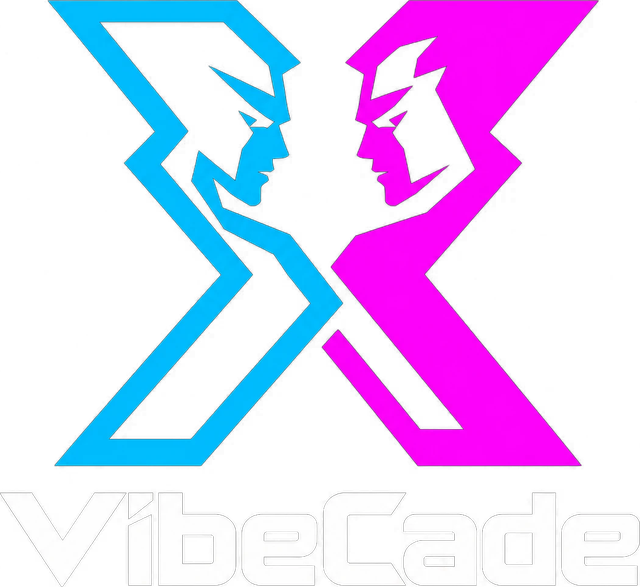

# VibeCade



**A social arcade on X.** Sign in with X, pick an app and go head-to-head with anyone:
reflex duels, rocket runs, strategy and 3D robot brawls.
Anyone can build and list their own app with the `vibecade-sdk`: start with
[Build your first game](docs/build-a-game.md), from `npm create vibecade` to a playable post on X.

- **Marketplace**: browse, search and filter apps. Each app card is a live animated vignette.
- **Challenges**: quick match, invite one or several `@handles`, or post an open challenge link to your timeline. Tables seat 2–8 players, with teams and spectators.
- **Play room**: every app runs inside a host that adds the drama: a VS intro, a 3-2-1 countdown, a HUD with presence and turn indicators, emoji reactions, results with XP and level-ups, rematch and share.
- **The Arena**: the crowd judges crowd-voted contests. Entries stay anonymous until you vote, and every vote earns XP.
- **Profiles and leaderboards**: XP, levels, streaks, and rankings overall and per app.
- **Developer portal**: SDK docs, app registration with a live preview, and a **Sandbox** that runs two copies of your app side by side with a live protocol log.

| Default app | Format | Scoring |
| --- | --- | --- |
| ⚡ Reflexes | Best-of-five reflex duel, with reaction times measured on each device | rounds won |
| 🔴 Four in a Row | Connect-four with physics and a minimax bot; play live or turn by turn over days | win/draw/loss |
| 🛻 Wedge Wars | 3D arena brawl for 2–4 players: armored wedge trucks with spinners, flippers, hammers and flamethrowers, with saws, flame vents and a KO pit | placement + damage |
| ✊ RPS Showdown | Example community app: **one HTML file**, commit-reveal included | rounds won |

The default apps are built on the **same public SDK** that third-party developers use. They're only special in that they're served from `/embed/*`.

---

## Quick start (demo mode, no setup)

```bash
npm install
npm run dev          # http://localhost:3000
```

Without Supabase keys, XApps runs in **demo mode**. Everything lives in your browser: a cast of personas, bots that accept challenges and fill quick-match lobbies, and a simulated crowd that votes in the Arena. To play yourself live, sign in as one persona in one tab and as another persona in a second tab. The tabs talk through `BroadcastChannel`, just like two players on Supabase Realtime.

## Going live: Supabase + Sign in with X

1. **Create a Supabase project.**
2. **Install the schema.** Run every file in [`supabase/migrations/`](supabase/migrations) in the SQL editor, oldest first. Or use the CLI: `npx supabase link --project-ref <ref> && npx supabase db push`. This creates the tables, row-level security, the match/vote/XP RPCs, realtime room authorization, the `meme-drops` storage bucket for dropped images, and seeds the default apps plus the practice bot. When you pull new migrations later, run just the new files. Migrations only change the platform: first-party apps are synced from the catalog (see *Official apps* under Deploy).
3. **Create an X app** in the [X developer portal](https://developer.x.com):
   - Turn on **OAuth 2.0** and choose the type *Web App*.
   - Set the callback URL to `https://<project-ref>.supabase.co/auth/v1/callback`.
   - Copy the **Client ID** and **Client Secret**.
4. **Enable the provider** in Supabase under *Authentication → Providers → X / Twitter (OAuth 2.0)* and paste the client ID and secret.
5. **Allow the redirect** under *Authentication → URL Configuration*:
   - Set the Site URL to your domain.
   - Add `http://localhost:3000/auth/callback` and `https://<your-domain>/auth/callback` to the redirect URLs.
6. **Configure the web app.** Copy [`.env.example`](.env.example) to `apps/web/.env.local` and fill in the values:

   ```bash
   NEXT_PUBLIC_SUPABASE_URL=https://<project-ref>.supabase.co
   NEXT_PUBLIC_SUPABASE_PUBLISHABLE_KEY=sb_publishable_...   # or NEXT_PUBLIC_SUPABASE_ANON_KEY
   NEXT_PUBLIC_SUPABASE_X_PROVIDER=                          # optional: auto-detects "x" or legacy "twitter"
   NEXT_PUBLIC_SITE_URL=http://localhost:3000
   ```

**App servers & webhooks (optional).** Apps can have their own server settle results through `/api/v1` and receive signed webhooks. Webhooks are sent from the database, so enable the **pg_net** and **pg_cron** extensions in Supabase (*Database → Extensions*) before running `20261001000000_trust.sql`. The migration schedules the jobs itself; if an extension is missing it skips that step and tells you. Developers manage secrets, webhooks and authority from the **Server** panel on their app's page.

If the keys are set but the schema isn't installed yet, the app says so and offers a one-click switch to demo mode.

## Deploy

**Vercel** (recommended): import the repo and set **Root Directory** to `apps/web`. Leave *Include files outside the root directory* on, because the app imports `packages/sdk`. [`apps/web/vercel.json`](apps/web/vercel.json) already installs from the monorepo root and runs `npm run build`, which bundles the SDK and then runs `next build`. Use Node 22 (anything from 20.9 works). Add the four variables from step 6 in *Settings → Environment Variables*, with `NEXT_PUBLIC_SITE_URL` set to your production URL. Then add `https://<your-domain>/auth/callback` to the Supabase redirect URLs. Without the Supabase variables, the deployment runs in demo mode.

**Official apps.** First-party apps live in code ([`apps/web/src/platform/catalog.ts`](apps/web/src/platform/catalog.ts)), not in migrations. `npm run sync-apps` upserts every app the catalog flags `official` into `public.apps` and reports each one as inserted, updated or unchanged (`npm run sync-apps -- --dry-run` prints the rows without connecting). An official app you delete from the catalog is **retired** by the next sync: its row is set to `rejected`, so it is no longer listed or playable, and its open, pending and active matches are cancelled; the row, finished matches and earned XP stay, and old matches still render under the app's name (`src/platform/retired-apps.ts`). It needs the Supabase **service role** key, so add `SUPABASE_SERVICE_ROLE_KEY` (or the new `SUPABASE_SECRET_KEY`, `sb_secret_…`) in Vercel as a server-only variable (never `NEXT_PUBLIC_`) for the **Production** environment. Every production build then runs the sync after `next build`, and a failed sync fails the deploy. Without the key the build skips the sync. Preview builds skip it too, so a branch never publishes its catalog to your database (set `SYNC_APPS=always` if previews use their own Supabase project, or `SYNC_APPS=off` to turn the sync off). Without Vercel, run `npm run sync-apps` with the key in your environment or `apps/web/.env.local` after deploying.

**Anywhere else**: `npm ci && npm run build && npm start` on Node 20.9+ serves on port 3000 (set `PORT` to change it).

**Reviewing community apps.** New submissions start as `pending` and are only visible to their developer. To publish one, run this in the SQL editor:

```sql
update public.apps set status = 'published' where slug = 'their-app';
```

## Playable posts on X

Paste `https://<your-domain>/x` (the whole catalog) or `https://<your-domain>/x/<slug>` (one app) into a post,
with no image attached. X reads its **player card** and runs `/x/play…` inline in the post (480×480) on desktop
web: guests pick a game and play the practice bots on their device, no sign-in. Challenging people opens the
site in a new tab. The mobile apps show the preview still (`/x/preview.png`, `/x/<slug>/preview.png`) and open
the link, which forwards to the site.

- **Challenging people from the post:** the card signs in with X through a popup (`/x/auth`), on its own session
  kept in the frame's storage (X's login page can't load in a frame and your session cookie isn't sent there). Then
  people quick-match, challenge an @handle, or post an open challenge whose link (`/x/m/<match>`) is itself a
  playable post: whoever sees it signs in and takes the seat inside the post. Add
  `https://<your-domain>/x/auth/callback` to Supabase's redirect URLs (Authentication → URL Configuration; for
  Vercel previews a wildcard like `https://*-<team>.vercel.app/**`), and apply the `x_auth_handoff` migration.
- Only `/x/play/*` and `/embed/*` may be framed by x.com and twitter.com, and the whole site by vibras.si
  (`frame-ancestors` in `apps/web/next.config.ts`). No `X-Frame-Options` is sent, and the player is never cached.
- Try it in a browser at `/x/preview` (`?app=<slug>` for one app): the player in a 480×480 frame inside a mock post.
- X caches a card's title, text and image for about a week, but the player is live. Add `?v=2` to force a new card.
- Set `NEXT_PUBLIC_X_HANDLE` to name your account as `twitter:site`. Validate a link with X's card validator, or by posting it.
- X has restricted and paused player cards before (they're meant for audio and video), so treat this as experimental.

## Live server for fast games

Frontline, Nova Rally and Wedge Wars send their live match traffic through the [Claude Arcade](https://github.com/realxhabib/ClaudeArcade)
server on your droplet instead of Supabase Realtime, whose message quota they outgrow. Match state, scores and results stay
in Supabase; turn-based games keep Supabase Realtime.

1. On the droplet, create `/etc/claudearcade.env` (see the Claude Arcade README, *XApps match rooms*) with your Supabase
   project URL, its anon / publishable key and `XAPPS_ORIGINS=https://<your-domain>`, re-run the arcade's install command,
   then `systemctl restart claudearcade`.
2. On Vercel, set `NEXT_PUBLIC_LIVE_SERVER_URL` to the arcade's address (e.g. `https://174-138-34-59.sslip.io`) and redeploy.

Unset, every game uses Supabase Realtime as before.

## Architecture

```
┌──────────────────────────── XApps host (Next.js) ────────────────────────────┐
│  Marketplace · Challenges · Arena · Profiles · Developer portal              │
│                                                                              │
│  /play/[id]  ── Play room: VS intro, HUD, reactions, voting, results         │
│      │  createHostBridge()  (origin-pinned postMessage)                      │
│      ▼                                                                       │
│  ┌───────────────── sandboxed <iframe> ─────────────────┐                    │
│  │  Any app: first-party (/embed/*) or community (https) │                   │
│  │  connect() · room.send/on · submit() · ui.* · storage │  ← vibecade-sdk     │
│  └────────────────────────────────────────────────────────┘                  │
│      │                                                                       │
│  Backend interface ── SupabaseBackend (Postgres RPCs + RLS, Realtime rooms)  │
│                    └─ DemoBackend (localStorage + BroadcastChannel + bots)   │
└──────────────────────────────────────────────────────────────────────────────┘
```

- **Apps never see a session token.** They run in a sandboxed iframe, the host only answers messages from the app's registered origin, and the SDK pins the host's origin after the handshake.
- **All match writes go through `SECURITY DEFINER` RPCs** (`submit_entry`, `cast_vote`, `claim_forfeit`, …). Clients can't touch match tables directly. The settlement logic (winner, XP, streaks, per-app stats) lives in one SQL function.
- **Contest entries stay private until voting**, so an opponent can't read your caption early. Realtime rooms are private channels (`match:<id>`) that only the match's players can join.
- **Everything shared is seeded.** Every client gets the same `match.seed`, so prompts, puzzles and delays match on both screens without extra messages.

```
apps/web/                  Next.js 16 app (App Router, React 19, Tailwind v4, Motion)
  src/app/(site)/          marketplace pages       src/app/play/     play room
  src/app/embed/<slug>/    first-party app frames  src/first-party/  their code
  src/platform/            backend interface, demo + Supabase backends, queries
  src/components/          chrome, motion primitives, marketplace, play room
packages/sdk/              vibecade-sdk: protocol, client, host bridge, React hooks
packages/create-vibecade/      `npx create-vibecade`: project templates (React, turn-based, one HTML file)
examples/rps/              a complete app in one HTML file
supabase/migrations/       schema, RLS, RPCs, realtime auth
supabase/tests/            lifecycle tests against a plain local Postgres
```

## Build and ship an app

```bash
npx create-vibecade my-game            # templates: react (default), turn-based, vanilla
cd my-game && npm install && npm run dev   # runs standalone against the SDK's mock host
```

1. **Register** it at `/developers/new`. That creates version 1.0.0, which goes to review. Add a square **icon** and a 16:9 **cover** there or in any later version. They're cropped and shrunk in the browser, stored in the `app-images` bucket (insert-only, so an approved image can't be swapped), and reviewed with the rest of the listing.
2. **Test** it in the Sandbox (both seats), then invite **testers**. Test builds are never ranked.
3. **Ship updates** as new versions from the app's console (`/developers/apps/<slug>`): Versions, Analytics, Logs, Server.
4. **Review.** Admins approve or request changes at `/admin/review`. Approved versions are published from the console.
   An app has at most one version in review. Submitting another replaces it in the queue, and **Edit submission** on a version in review saves your changes as the next patch (1.1.0 → 1.1.1), which takes its place. Reviewers only ever see the latest.

To make someone an admin, run `update public.profiles set is_admin = true where handle = '<handle>';` in the SQL editor. In demo mode, the review page has a "Become admin" switch.

`vibecade-sdk` and `create-vibecade` are ready for npm (`npm publish` from `packages/sdk` and `packages/create-vibecade`). Until you publish them, scaffolded projects can't install the SDK.

## The SDK in 10 lines

Start from a template (no network needed to scaffold):

```bash
npx create-vibecade my-game          # --template react (default) | turn-based | vanilla
cd my-game && npm install && npm run dev
```

Or add the SDK to any project (`npm i vibecade-sdk`):

```ts
import { connect } from "vibecade-sdk"; // or "https://<xapps-host>/sdk/v1.js" with no build step

const xapps = await connect();
xapps.room.on("move", (move, from) => apply(move, from));
xapps.onStart(() => startGame());
await xapps.ready();
// …
await xapps.submit({ score: 42 });
```

Full reference: the `/developers` page in the app and [`packages/sdk/README.md`](packages/sdk/README.md). You can open your app directly and the SDK starts a mock host with a bot opponent. Use `/developers/sandbox` to test both seats.

## Scripts

| Command | What it does |
| --- | --- |
| `npm run dev` | Builds the SDK bundle and starts Next.js on :3000 |
| `npm run build` / `npm start` | Production build and serve (the build also syncs official apps when a service role key is set) |
| `npm run sync-apps` | Upserts the first-party apps from the catalog into Supabase and retires official apps it no longer has (`-- --dry-run` prints the rows) |
| `npm test` | Unit tests (SDK protocol, game logic, scoring) |
| `npm run typecheck` / `npm run lint` | TypeScript and ESLint |
| `npm run test:e2e` | Playwright end-to-end run in demo mode |
| `supabase/tests/run.sh` | Applies the migrations to a throwaway local Postgres, replays the official app sync, and checks the whole match lifecycle, RLS included |

## Known limitations

- **Scores are client-reported by default.** Deterministic seeds and commit-reveal limit cheating. Apps that need more can switch to server authority (Stage 2), where only the app's own server can settle a match. Stats and achievements from client-authority apps are trusted the same way.
- **Demo uploads live in memory.** In demo mode, `/api/demo-media` keeps files in the server process, so they're lost on restart and aren't shared across serverless instances.
- **Crowd-judged content is user-generated.** Before a public launch, add reporting and moderation for captions and takes.
- **Async runs aren't locked.** A player who leaves before submitting can replay the run.

